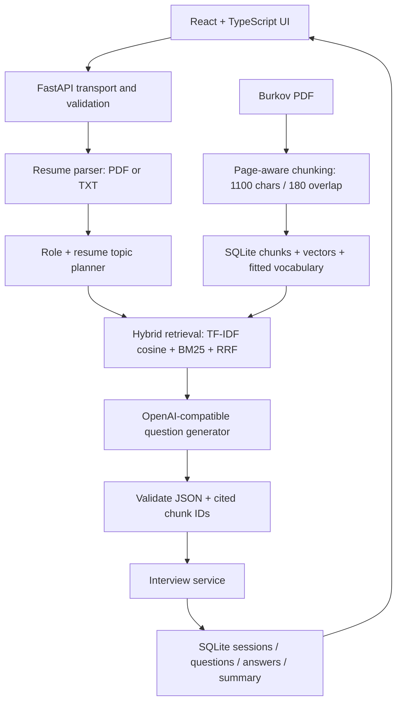

# Groundwork - resume-aware candidate screening

A complete React + FastAPI application for structured, textbook-grounded technical interviews. Upload a resume, select a role, inspect the retrieval evidence, answer questions, and export the persisted interview trace.

**For the assignment demo, use `GENERATION_MODE=llm`.** The default `practice` mode is an explicitly labelled, deterministic scaffold for testing the flow without a model. It is not AI question generation and is not a substitute for the mandatory model-powered demo.

## Quick start

Requirements: Python 3.10+, Node.js 20.19+ or 22.12+, and an OpenAI-compatible model endpoint for the AI demo. No GPU is required for the application itself.

```bash
# In the repository root
python -m venv .venv
# macOS/Linux
source .venv/bin/activate
# Windows PowerShell: .venv\Scripts\Activate.ps1
pip install -r backend/requirements.txt
cp .env.example .env
# Windows PowerShell: Copy-Item .env.example .env
python scripts/download_corpus.py
cd backend
uvicorn app.main:app --host 127.0.0.1 --port 8000
```

In a second terminal:

```bash
cd frontend
npm ci
npm run dev
```

Open http://localhost:5173. API docs: http://127.0.0.1:8000/docs. Health/index diagnostics: http://127.0.0.1:8000/api/health. Initial textbook ingestion happens once at backend startup. The supplied resumes in `examples/` are synthetic; no real candidate data is in this repository.

### Real dynamic questions with Ollama (free, local)

Install Ollama from https://ollama.com and start it. Pull an instruction model:

```bash
ollama pull qwen2.5:3b
```

Set these values in root `.env`, then restart the backend:

```dotenv
GENERATION_MODE=llm
LLM_BASE_URL=http://localhost:11434/v1
LLM_MODEL=qwen2.5:3b
LLM_API_KEY=ollama
LLM_TIMEOUT=180
```

The 3B model needs several GB of available RAM and its first request may be slow. A larger instruction model generally gives better questions. The endpoint must support chat completions with `response_format: {"type":"json_object"}`. For another OpenAI-compatible provider, set its `/v1` base URL, model and API key in `.env`. Never put keys in frontend code or commit `.env`.

The system does **not** silently switch to practice questions if a model fails. Invalid JSON, invalid citations, timeouts or provider errors return a visible 502; no partial session is stored. Correct the model configuration and retry. Health `ready` means the *knowledge index* is ready, not that a model request has succeeded.

## Architecture



- `backend/app/main.py`: thin API layer, bounded upload reads, actionable HTTP errors.
- `services/resume.py`: text extraction, skill/domain dictionary and explicit difficulty heuristic.
- `services/generation.py`: role planning, model boundary, prompt and output validation.
- `services/knowledge.py`: persistent ingestion, exact vector retrieval and lexical fusion.
- `services/interview.py`: lifecycle rules, atomic response handling and descriptive summary.
- `db.py`: schema, foreign keys, transactional connections and WAL.
- `frontend/src/`: upload, role selection, staged interview, evidence drawer, restore/delete/export.

### Pipeline and key decisions

1. **Book-grounded corpus, not web answers.** Primary source is *The Hundred-Page Machine Learning Book* (Andriy Burkov, 2019), one of the assignment's specified resources. The original assignment mirror failed TLS validation. The download script uses the same book from a GitHub mirror over verified TLS, pins SHA-256, and refuses changed bytes. The PDF and extracted index are intentionally not committed. Source: https://themlbook.com/ and https://github.com/lyric12345/The-Hundred-Page-Machine-Learning-Book-by-Andriy-Burkov . Buy the book if it is useful; follow its read-first/buy-later terms. The MIT code license does not apply to the textbook.
2. **Context-preserving chunks.** Text is normalized and chunked within each PDF page with overlap. No chunk crosses a page, so citations remain easy to inspect. Front matter (first 11 PDF pages) is skipped. Character windows may still split sentences; sentence/section-aware chunking is a next improvement. There are 321 chunks in the pinned book.
3. **Explainable embeddings and a real persistent vector store.** Corpus-fitted TF-IDF vectors (up to 2048 dimensions, L2-normalized) are saved alongside chunks in SQLite. NumPy performs exact cosine/dot-product retrieval. These are lexical embeddings, **not neural semantic embeddings**. BM25 adds a second ranking and reciprocal-rank fusion combines the top 20 of each (`1/(60+rank)`). One result per page avoids overlapping duplicate context. This is efficient enough for one textbook; it is not an ANN/vector-database service. At larger scale, use a neural embedder and pgvector/Qdrant with the same retrieval interface.
4. **Builds on my existing ragkit.** The MIT-licensed chunker, tokenizer, TF-IDF embedder, BM25 and document data classes are vendored from https://github.com/Prajit-22/ragkit, rather than concealing a network dependency. Attribution and license are retained in `backend/vendor/ragkit/`. Snapshot provenance is in `docs/design.md`.
5. **Resume changes the interview.** Extracted skills choose anchors (RAG/NLP for ML, API/SQL skills for backend), role-specific concepts shape the query, and a seniority keyword heuristic changes the requested difficulty. Background/project lines are included as model data, not instructions. Skills and seniority extraction are intentionally simple and imperfect, and the UI states that limitation.
6. **Questions are dynamically generated in model mode.** Each question gets a plan, textbook evidence and previous generated questions. Stored traces include query, resume anchor, model, generation mode, cited IDs, full retrieved passages and corpus checksum. A prompt guards against resume instructions; schema validation rejects fabricated citation IDs. Valid IDs are traceability, not a proof of semantic entailment. Human review remains necessary. Questions are generated as a batch before storing the session. Answer-adaptive follow-ups are not implemented (optional in the brief).
7. **Persistence before convenience.** SQLite uses foreign keys and a unique session/ordinal pair. `BEGIN IMMEDIATE` serializes answer checks and writes, preventing duplicate/out-of-order overwrites. Questions and the complete-session summary are stored, not re-generated on refresh. A random 128-bit session ID acts as the private access capability for this local demo.
8. **Honest insights.** The summary gives topics, answer count, response lengths and review prompts. It does not pretend word count is technical correctness or issue an automated hiring verdict.

## API lifecycle

| Endpoint | Purpose |
| --- | --- |
| `GET /api/health` | Index readiness, mode, model, corpus checksum |
| `GET /api/roles` | Supported roles and topic scope |
| `POST /api/sessions` | Multipart `resume` + `role`; generate then atomically save |
| `GET /api/sessions/{id}` | Restore questions, responses and summary |
| `POST /api/sessions/{id}/answers` | JSON `question_id`, `answer`; accept current question only |
| `DELETE /api/sessions/{id}` | Delete session and cascade questions/answers |

State: `active` → all questions answered → `complete`. Unsupported input is 422, unknown session 404, stale/wrong-order submission 409, unavailable corpus 503, failed model output 502. Session creation saves nothing if any question generation fails.

## Testing

```bash
# With the venv activated and the corpus downloaded
cd backend
pytest -q
cd ../frontend
npm run build
```

Tests cover real-corpus retrieval and index reload, resume/role query changes, full lifecycle, persistence through a fresh app instance, invalid uploads, answer ordering/duplicates, deletion cascade, missing corpus, model JSON/citation validation and no partial sessions on model failure. Model contract tests use mocks and do not claim real inference. UI verification uses a real running backend and Playwright (`scripts/e2e.py`, install Playwright separately).

```bash
pip install playwright
playwright install chromium
# Start both servers, then from the repository root:
python scripts/e2e.py
```

## Boundaries before deployment

This is a local assignment prototype, not a production hiring product. Bind only to loopback. There is no user authentication, per-user authorization, request rate limiting or encryption at rest. Anyone with a session ID and server access can read/delete that session; do not expose it to the internet without those controls. Use synthetic resumes when testing shared endpoints. The app retains extracted profile data (not original resume bytes). Delete a session through the UI to remove its profile and answers. Model mode sends that profile and excerpts to the configured provider; choose a local endpoint for local-only processing.

PDF uploads must be text-based (OCR is not included), unencrypted and at most 10 pages/2 MB. The backend role deliberately tests ML serving and data pipelines because the assigned corpus is ML, not an invented backend textbook. The UI uses a Google Fonts stylesheet with system-font fallbacks; internet loss does not block functionality.

See `docs/demo-script.md` for the mandatory video walkthrough and `docs/design.md` for interview preparation.
